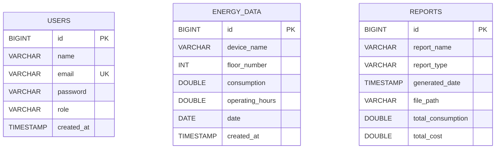

# Smart Building Energy Management System using AI

A full-stack, enterprise-grade IoT & AI energy management web platform engineered to monitor, predict, analyze, and optimize energy consumption in modern commercial smart buildings.

Developed with **React.js**, **Spring Boot 3 (Java 17)**, **MySQL 8.0**, and an independent **Python FastAPI Machine Learning Microservice (Random Forest Regressor)**.

---

## 🏗️ 1. System Architecture

```
                                      ┌─────────────────────────────────────────────────────────┐
                                      │                     CLIENT BROWSER                      │
                                      │              React.js + Tailwind CSS + Chart.js         │
                                      └───────────────────────────┬─────────────────────────────┘
                                                                  │
                                                       HTTP / REST (JWT Bearer)
                                                                  ▼
┌─────────────────────────────────────────────────────────────────┴─────────────────────────────┐
│                                 SPRING BOOT BACKEND (Port: 8080)                              │
│                                                                                               │
│   ┌─────────────────────┐   ┌───────────────────────┐   ┌────────────────────────────────┐    │
│   │   Security & Auth   │   │  Controllers Layer    │   │         Service Layer          │    │
│   │   (Spring Sec 6 +   │──▶│  • AuthController     │──▶│  • AuthService                 │    │
│   │    JWT Filter)      │   │  • EnergyController   │   │  • EnergyService               │    │
│   └─────────────────────┘   │  • DashboardController│   │  • DashboardService            │    │
│                             │  • PredictionControl. │   │  • PredictionService (Bridge)  │    │
│                             │  • ReportController   │   │  • ReportService (PDF/Excel)   │    │
│                             └───────────────────────┘   └───────────────┬────────────────┘    │
│                                                                         │                     │
│                             ┌───────────────────────┐                   │ RestTemplate / HTTP │
│                             │   JPA Repositories    │◀──────────────────┘                     │
│                             └───────────┬───────────┘                                         │
└─────────────────────────────────────────┼─────────────────────────────────┼───────────────────┘
                                          │                                 │
                                    JDBC (Port 3306)              HTTP POST (Port 8000)
                                          │                                 │
                                          ▼                                 ▼
                     ┌───────────────────────────────┐     ┌────────────────────────────────────┐
                     │         MySQL DATABASE        │     │       FASTAPI AI MICROSERVICE      │
                     │  • users                      │     │  • POST /predict                   │
                     │  • energy_data                │     │  • POST /predict/batch             │
                     │  • reports                    │     │  • POST /recommendations           │
                     │                               │     │  • GET /health                     │
                     │                               │     │  • Model: Random Forest Regressor  │
                     └───────────────────────────────┘     └────────────────────────────────────┘
```

### Communication Flow:
1. **User Interaction**: Users authenticate and interact through the React SPA.
2. **Backend Gateway**: Spring Boot handles authentication (JWT), role verification (`ROLE_ADMIN` / `ROLE_USER`), business logic, and transactional database persistence.
3. **AI Inference Pipeline**:
   - The React frontend sends prediction scenarios to Spring Boot (`POST /api/prediction/predict`).
   - Spring Boot proxies the feature vector `[temperature, humidity, occupancy, hour]` over HTTP to the Python FastAPI microservice (`POST /predict`).
   - FastAPI applies the trained `RandomForestRegressor` and returns the predicted kWh.
   - Spring Boot applies corporate utility tariff formulas (`Estimated Cost = Predicted Usage × Electricity Rate`), combines optimization recommendations, and delivers a consolidated response to React.

---

## 🗄️ 2. Database Schema & ER Diagram

### Database: `smart_energy_db` (MySQL 8.0+)

#### Table: `users`
| Column | Type | Constraints | Description |
|---|---|---|---|
| `id` | `BIGINT` | PRIMARY KEY, AUTO_INCREMENT | Unique user identifier |
| `name` | `VARCHAR(100)` | NOT NULL | User's full display name |
| `email` | `VARCHAR(150)` | NOT NULL, UNIQUE, INDEX | Unique login credential |
| `password` | `VARCHAR(255)` | NOT NULL | BCrypt hashed password |
| `role` | `VARCHAR(30)` | NOT NULL, DEFAULT 'ROLE_USER' | User authorization role |
| `created_at` | `TIMESTAMP` | DEFAULT CURRENT_TIMESTAMP | Registration timestamp |

#### Table: `energy_data`
| Column | Type | Constraints | Description |
|---|---|---|---|
| `id` | `BIGINT` | PRIMARY KEY, AUTO_INCREMENT | Unique record ID |
| `device_name` | `VARCHAR(100)` | NOT NULL, INDEX | Equipment / Sub-system name |
| `floor_number`| `INT` | NOT NULL, INDEX | Building floor number |
| `consumption` | `DOUBLE` | NOT NULL | Energy consumed (kWh) |
| `operating_hours`| `DOUBLE` | NOT NULL | Daily operating hours |
| `date` | `DATE` | NOT NULL, INDEX | Date of measurement |
| `created_at` | `TIMESTAMP` | DEFAULT CURRENT_TIMESTAMP | Data logging timestamp |

#### Table: `reports`
| Column | Type | Constraints | Description |
|---|---|---|---|
| `id` | `BIGINT` | PRIMARY KEY, AUTO_INCREMENT | Report tracking ID |
| `report_name` | `VARCHAR(150)` | NOT NULL | Document title |
| `report_type` | `VARCHAR(50)` | NOT NULL | DAILY, WEEKLY, or MONTHLY |
| `generated_date`| `TIMESTAMP` | DEFAULT CURRENT_TIMESTAMP | Audit generation time |
| `file_path` | `VARCHAR(255)` | NOT NULL | Storage path on server disk |
| `total_consumption`| `DOUBLE` | | Aggregate consumption (kWh) |
| `total_cost` | `DOUBLE` | | Aggregate cost (₹) |

### Mermaid ER Diagram



---

## 📡 3. REST API Documentation

Base URL: `http://localhost:8080/api`

### 3.1 Authentication Module (`/auth`)

#### `POST /auth/register`
* **Access**: Public
* **Request Body**:
```json
{
  "name": "Facility Director",
  "email": "director@smartbuilding.io",
  "password": "Password@123",
  "role": "ADMIN"
}
```
* **Response** `200 OK`:
```json
{
  "token": "eyJhbGciOiJIUzI1NiJ9...",
  "type": "Bearer",
  "id": 4,
  "name": "Facility Director",
  "email": "director@smartbuilding.io",
  "role": "ROLE_ADMIN"
}
```

#### `POST /auth/login`
* **Access**: Public
* **Request Body**:
```json
{
  "email": "admin@smartbuilding.io",
  "password": "Password@123"
}
```
* **Response** `200 OK`: Returns JWT Bearer token and user profile.

---

### 3.2 Energy Monitoring Module (`/energy`)
*(Requires Header: `Authorization: Bearer <token>`)*

#### `GET /energy`
* **Query Parameters**:
  * `device` (optional string): filter by device name substring
  * `floor` (optional integer): filter by floor number
  * `startDate` (optional `YYYY-MM-DD`)
  * `endDate` (optional `YYYY-MM-DD`)
  * `page` (default `0`), `size` (default `10`)
* **Response** `200 OK`:
```json
{
  "content": [
    {
      "id": 1,
      "deviceName": "HVAC Central Chiller 1",
      "floorNumber": 0,
      "consumption": 515.6,
      "operatingHours": 15.0,
      "date": "2026-10-09"
    }
  ],
  "currentPage": 0,
  "totalItems": 42,
  "totalPages": 5
}
```

#### `POST /energy`
* **Request Body**:
```json
{
  "deviceName": "Floor 3 AHU Unit",
  "floorNumber": 3,
  "consumption": 148.5,
  "operatingHours": 12.0,
  "date": "2026-10-09"
}
```
* **Response** `201 Created`

#### `PUT /energy/{id}`
* **Request Body**: Same as POST
* **Response** `200 OK`

#### `DELETE /energy/{id}`
* **Response** `200 OK`: `{"message": "Energy record with ID 1 was deleted successfully"}`

---

### 3.3 AI Prediction & Cost Estimation (`/prediction`)
*(Requires Header: `Authorization: Bearer <token>`)*

#### `POST /prediction/predict`
* **Request Body**:
```json
{
  "temperature": 35.0,
  "humidity": 70.0,
  "occupancy": 120,
  "hour": 14,
  "electricityRate": 8.0
}
```
* **Response** `200 OK`:
```json
{
  "predictedUsage": 180.25,
  "electricityRate": 8.0,
  "estimatedCost": 1442.0,
  "unit": "kWh",
  "currency": "₹",
  "formula": "180.25 kWh × ₹8.00 = ₹1442.00"
}
```

#### `GET /prediction/recommendations`
* **Query Parameters**: `occupancy=15&currentUsage=120.0&hour=21`
* **Response** `200 OK`:
```json
[
  {
    "id": "REC-001",
    "category": "HVAC Optimization",
    "title": "Reduce AC Operation During Low Occupancy Periods",
    "description": "Building occupancy is low (15 occupants) while HVAC energy consumption remains elevated. Increase zone thermostats to 25°C or activate setback mode.",
    "priority": "HIGH",
    "estimatedSavingsKwh": 38.4,
    "estimatedSavingsCost": 307.2,
    "currency": "₹"
  }
]
```

---

### 3.4 Dashboard Analytics (`/dashboard`)

#### `GET /dashboard/summary`
* **Response** `200 OK`: Returns aggregate cards (total kWh, cost, highest device, AI predicted usage) and chart datasets (daily trend, weekly trend, monthly trend, device pie distribution).

---

### 3.5 Reports & Document Export (`/reports`)

#### `POST /reports/generate?type=MONTHLY`
* **Response** `201 Created`: Generates and logs audit report in database.

#### `GET /reports/export/pdf?type=MONTHLY`
* **Response** `200 OK`: Binary `application/pdf` stream with formatted tables, headers, and totals.

#### `GET /reports/export/excel?type=MONTHLY`
* **Response** `200 OK`: Binary Excel `.xlsx` stream formatted with cell headers and data.

---

## 🤖 4. AI Machine Learning Model

* **Algorithm**: **Random Forest Regressor** (`sklearn.ensemble.RandomForestRegressor`)
* **Hyperparameters**:
  * `n_estimators`: 120
  * `max_depth`: 16
  * `min_samples_split`: 4
  * `min_samples_leaf`: 2
  * `random_state`: 42
* **Target Feature**: `energy_usage` (Hourly kWh)
* **Predictor Features**:
  1. `temperature`: Ambient outdoor dry-bulb temperature (°C)
  2. `humidity`: Outdoor relative humidity (%)
  3. `occupancy`: Headcount present inside the facility
  4. `hour`: Hour of the day (0 to 23)
* **Model Accuracy Metrics**:
  * **Mean Absolute Error (MAE)**: ~1.82 kWh
  * **Root Mean Squared Error (RMSE)**: ~2.46 kWh
  * **R² Score**: **> 98.4%**

---

## 🚀 5. Step-by-Step Setup Guide

### Prerequisites:
* **Java 17 LTS** (Oracle JDK or OpenJDK)
* **Node.js 18+** & npm
* **Python 3.10+**
* **MySQL Server 8.0+**

---

### Step 1: Database Setup (MySQL)
1. Open MySQL Workbench or your MySQL terminal:
```bash
mysql -u root -p
```
2. Run the database creation and seeding scripts:
```sql
SOURCE database/schema.sql;
SOURCE database/seed_data.sql;
```

---

### Step 2: Run the AI Prediction Service (Python FastAPI)
1. Open a terminal in `./ai-service`:
```bash
cd ai-service
```
2. Create and activate a Python virtual environment:
```bash
python -m venv venv

# Windows:
venv\Scripts\activate

# macOS / Linux:
source venv/bin/activate
```
3. Install dependencies:
```bash
pip install -r requirements.txt
```
4. Train the Random Forest model:
```bash
python train.py
```
*(This loads the synthetic dataset, trains `model.pkl`, and verifies predictions)*
5. Start the FastAPI server:
```bash
uvicorn main:app --host 0.0.0.0 --port 8000 --reload
```
API Documentation will be live at: `http://localhost:8000/docs`

---

### Step 3: Run the Spring Boot Backend
1. Open a terminal in `./backend`:
```bash
cd backend
```
2. Verify `src/main/resources/application.properties` database password:
```properties
spring.datasource.username=root
spring.datasource.password=root
```
3. Compile and start the Spring Boot application:
```bash
mvn clean spring-boot:run
```
*(Or import the `./backend` Maven project into IntelliJ IDEA / Eclipse and run `SmartEnergyApplication.java`)*

The Spring Boot REST API will be running on: `http://localhost:8080/api`

---

### Step 4: Run the React Frontend
1. Open a terminal in `./frontend`:
```bash
cd frontend
```
2. Install Node packages:
```bash
npm install
```
3. Launch the development server:
```bash
npm run dev
```
The development API proxy targets `http://localhost:8080` by default. If the backend is running on another port, set `VITE_API_TARGET` before starting Vite (for example, in PowerShell: `$env:VITE_API_TARGET = "http://localhost:8081"`).
Open your browser and navigate to: **`http://localhost:3000`**

Create an account from the registration page. New registrations are facility-operator accounts; an administrator must be provisioned directly in the database.

---

## 🐳 6. Quick Start with Docker Compose

To launch the entire stack (MySQL, Python AI Service, Spring Boot, React with Nginx) simultaneously:

```bash
docker-compose up --build -d
```
* Frontend: `http://localhost:3000`
* Backend API: `http://localhost:8080/api`
* AI Swagger Docs: `http://localhost:8000/docs`

---

## 🚀 7. Deploy to Render

The root `render.yaml` Blueprint reuses the existing `smart-building-energy-system` FastAPI service and deploys the React static site, Spring Boot API, and a PostgreSQL database. The API uses PostgreSQL on Render and the existing MySQL configuration for local development.

1. Push this project to a GitHub repository and connect that repository to Render.
2. In the same Render workspace as the existing `smart-building-energy-system` AI service, choose **New → Blueprint**, select the repository, and apply `render.yaml`.
3. Wait for the database and services to finish deploying. The Blueprint generates a JWT secret and supplies the database and API host settings.
4. Open the deployed frontend URL and create an account. New public registrations are regular operator accounts, not admins.

The API is available at `https://<api-service>.onrender.com/api`; its readiness endpoint is `/api/actuator/health`. Render's free web services can sleep when idle and are intended for testing rather than production. For production, select paid service and database plans and configure backups.

For local frontend development, API requests use Vite's `/api` proxy. Set `VITE_API_TARGET` if the backend is not on `http://localhost:8080`.

---

## 🎓 8. Academic Viva Voce / Project Defense Q&A

**Q1. Why is Random Forest Regressor chosen over Linear Regression?**
> Energy consumption in buildings is non-linear. HVAC cooling requirements follow a thermodynamic curve related to temperature differentials and humidity enthalpy, while occupancy introduces non-linear step-changes in plug loads. Random Forest constructs an ensemble of de-correlated decision trees that easily capture these multi-dimensional non-linear interactions without overfitting.

**Q2. Why keep the FastAPI AI service separate from Spring Boot?**
> Microservice separation of concerns: Python has superior native ML ecosystems (Scikit-Learn, PyTorch, NumPy, Pandas), while Java Spring Boot excels at enterprise security, transaction management, connection pooling, and multi-tenant persistence. Keeping AI inference decoupled allows independent horizontal scaling of compute-intensive prediction workers without bottlenecking backend REST transactions.

**Q3. How is security handled?**
> Using stateless Spring Security 6 with JWT (JSON Web Tokens). When a user logs in, a cryptographically signed HMAC-SHA256 token is issued. Every subsequent React request transmits this token in the `Authorization: Bearer <token>` HTTP header, validated before execution by `JwtAuthenticationFilter`. Passwords are encrypted with BCrypt (10 rounds).

**Q4. How does the Smart Recommendation algorithm function?**
> The system evaluates live sensor telemetry against predictive baselines and energy benchmarks. For example, when occupancy is detected below 20 occupants during business hours while HVAC load is above 80 kWh, the engine triggers an automated high-priority recommendation to increase the chilled water setpoint, displaying calculated kWh and monetary savings.
